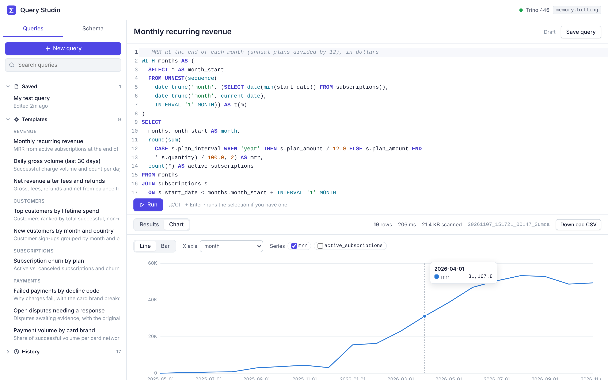

# sigma-prototype: Query Studio

A SQL analysis workspace modeled on the Stripe Sigma workflow, with Trino as the query engine.

You get a schema browser, a SQL editor with autocomplete, a results grid, quick charts, saved queries, templates and run history. The UI uses its own name and styling and carries no Stripe branding.



## Features

- **SQL editor** (CodeMirror 6) with Trino keywords and functions, plus autocomplete for tables and columns taken from the live schema.
  - Run with **⌘/Ctrl + Enter**. If text is selected, only the selection runs.
  - Save with **⌘/Ctrl + S**.
- **Schema browser** that reads `information_schema` from the catalogs and schemas you configure.
  - Search across tables and columns.
  - Columns show their types and descriptions.
  - Hover a table for **Insert** (adds the table name to the editor) or **Preview** (runs `SELECT * … LIMIT 100`).
- **Async execution** that follows the Trino client protocol.
  - While a query runs you see its queued/running state, progress, elapsed time and rows scanned.
  - **Cancel** kills the query in Trino.
  - Results are capped at `MAX_ROWS`. Once the cap is reached, the query is stopped so it doesn't stream everything.
- **Results grid**:
  - sticky headers that show column types
  - click a header to sort
  - numbers are right-aligned and NULLs are shown explicitly
  - 100 rows per page
  - **CSV download**
- **Chart view**:
  - line or bar chart
  - choose the X axis and the series
  - hover tooltip
  - light and dark themes
- **Saved queries** that persist on the server.
  - The URL links to the open query (`#/queries/<id>`).
  - Save as… and Delete are available.
- **Templates** for common billing analyses: MRR, gross volume, net revenue, churn, failed payments, disputes and more.
- **History** of recent runs.
- **Read-only by default**: only `SELECT / WITH / SHOW / DESCRIBE / EXPLAIN` statements are accepted, one statement per run. Set `ALLOW_WRITES=true` to lift this.
- **Sample dataset**: on startup the server seeds `memory.billing` with deterministic, realistic billing data. Tables:
  - `customers`, `products`, `prices`, `subscriptions`
  - `invoices`, `charges`, `refunds`, `disputes`, `balance_transactions`

## Architecture

```
browser (React + Vite)  ──/api──▶  Node/Express server  ──HTTP /v1/statement──▶  Trino coordinator
                                    │  query runner (poll, cap, cancel)
                                    │  schema introspection (information_schema)
                                    └─ data/store.json (saved queries + history)
```

The server talks to Trino over its REST client protocol directly (`server/src/trino.js`), so it needs no driver. The browser never connects to Trino. Every query goes through the server, which validates it, runs it as the configured user and holds the result rows so the UI can page through them and export them.

## Quick start (Docker)

```bash
docker compose up --build
```

Then open http://localhost:3001. Trino's own UI is at http://localhost:8080.

## Local development

You need Node 22+ and a Trino server. The sample data uses the `memory` catalog, and the schema browser also lists `tpch.tiny`. To get both, use the catalog files in `trino/catalog/`.

To start only Trino:

```bash
docker compose up trino
```

In another terminal:

```bash
npm install
```

```bash
npm run dev
```

`npm run dev` starts the API on :3001 and Vite on http://localhost:5173, which proxies `/api` to the API.

For a production-style run:

```bash
npm run build && npm start
```

This serves the built UI from the API server on :3001.

### Tests

```bash
npm test
```

This runs the unit tests and the API tests against a fake Trino.

```bash
TRINO_SERVER=http://localhost:8080 npm test
```

This also seeds a real Trino and runs every template against it.

## Configuration

These are environment variables for the server:

| Variable | Default | Purpose |
|---|---|---|
| `TRINO_SERVER` | `http://localhost:8080` | Trino coordinator URL |
| `TRINO_USER` | `sigma` | User sent as `X-Trino-User` |
| `TRINO_PASSWORD` | – | Enables HTTP basic auth (Trino requires HTTPS for this) |
| `TRINO_CATALOG` / `TRINO_SCHEMA` | `memory` / `billing` | Default catalog/schema, so unqualified table names resolve |
| `SCHEMA_BROWSER` | `memory.billing,tpch.tiny` | Comma-separated `catalog.schema` (or `catalog`) list to show in the schema browser |
| `MAX_ROWS` | `10000` | Maximum rows kept per run |
| `ALLOW_WRITES` | `false` | Allow non-read-only statements |
| `SEED` | `true` | Seed the sample dataset on startup (skipped if it already exists) |
| `SEED_CATALOG` / `SEED_SCHEMA` | the default catalog/schema | Where to seed |
| `PORT` | `3001` | HTTP port |
| `DATA_DIR` | `./data` | Where saved queries and history are stored |

To point the app at your own data, set `TRINO_CATALOG`, `TRINO_SCHEMA` and `SCHEMA_BROWSER` to the catalogs Trino already serves (Hive, Iceberg, Postgres, …). Set `SEED=false` if that catalog isn't writable.

## HTTP API

| Method & path | Description |
|---|---|
| `GET /api/config` | Trino version, default catalog/schema, limits |
| `GET /api/schema[?refresh=1]` | Tables and columns for the configured schemas |
| `GET /api/templates` | Starter queries |
| `POST /api/runs` `{sql}` | Start a query and return the run |
| `GET /api/runs/:id?wait=ms&offset=&limit=` | Run status (long-polls up to 5s with `wait`) and a page of rows |
| `POST /api/runs/:id/cancel` | Cancel the run and the Trino query |
| `GET /api/runs/:id/csv` | Download the results as CSV |
| `GET /api/history` | Recent runs |
| `GET/POST/PUT/DELETE /api/queries[/:id]` | Saved queries |
